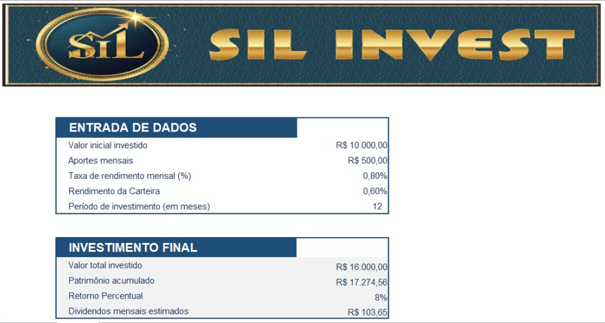
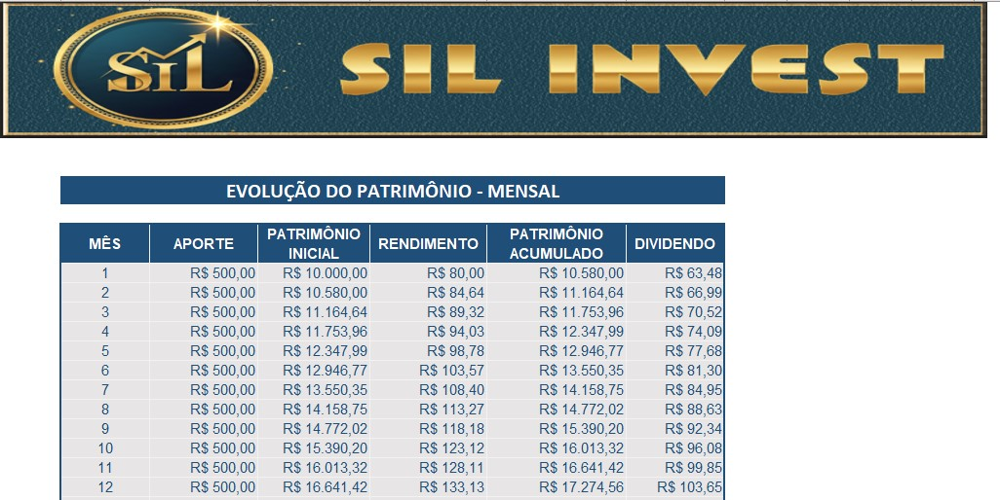
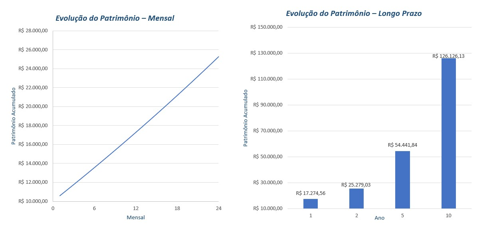

# 📊 Simulador de Investimentos em Fundos Imobiliários (Proj SIL)

Este projeto foi desenvolvido como parte de um desafio da **DIO** para aplicar conceitos de **Excel** na criação de uma ferramenta prática de simulação de investimentos em **Fundos Imobiliários (FIIs)**.  

A planilha permite calcular:

-  Valor total investido  
-  Patrimônio acumulado ao longo do tempo  
-  Retorno percentual  
-  Dividendos mensais estimados  
-  Evolução do patrimônio em diferentes horizontes (1, 2, 5 e 10 anos)  
---

## 🚀 Funcionalidades
- **Entrada de dados**:  valor inicial, aportes mensais, taxa de rendimento, rendimento da carteira e período de investimento.  
- **Simulação mensal**:  evolução do patrimônio até 120 meses, com cálculo de rendimento e dividendos.  
- **Investimento final**: resumo com valor total investido, patrimônio acumulado, retorno percentual e dividendos mensais.  
- **Gráficos automáticos**:
  - 📈 Linha: evolução mês a mês (até 24 meses).  
  - 📊 Colunas: patrimônio acumulado em períodos maiores (1, 2, 5 e 10 anos).  

## 📂 Estrutura da planilha
### Aba **Entrada**
- Entrada de Dados  
- Investimento Final  
- Evolução de Patrimônio (1, 2, 5, 10 anos)  

### Aba **Simulação**
- Tabela com evolução mensal (até 120 meses)  
- Fórmulas automáticas para patrimônio inicial, rendimento, acumulado e dividendos  

## 🧮 Fórmulas principais
- **Valor total investido** =valor_inicial+(aporte_mensal*meses)  
- **Patrimônio acumulado** =VF(taxa;meses;-aporte_mensal;-valor_inicial)
- **Retorno percentual** =(patrimonio_acumulado-ValorTotalInvestido)/ValorTotalInvestido
- **Dividendos mensais estimados** =patrimonio_acumulado*rendimento_carteira

## 📸 Capturas de tela

### Entrada de Dados  

### Simulação Mensal:

### Gráficos

## 🛠️ Como usar
1.	Abra a planilha **Proj SIL.xlsx**.
2.	Preencha os campos na aba **Entrada**.
3.	Veja os resultados automáticos em **Investimento Final**.
4.	Explore a aba **Simulação** para detalhes mês a mês.
5.	Analise os gráficos para visualizar o crescimento do patrimônio.

## 📚 Aprendizados
- Aplicação de fórmulas financeiras no Excel (FV, rendimento composto, dividendos).
- Estruturação de tabelas dinâmicas para simulação.
- Criação de gráficos comparativos para análise de curto e longo prazo.
- Documentação técnica e compartilhamento no GitHub.

## 📄 Licença

- Este projeto é de uso educacional e pode ser adaptado livremente.

