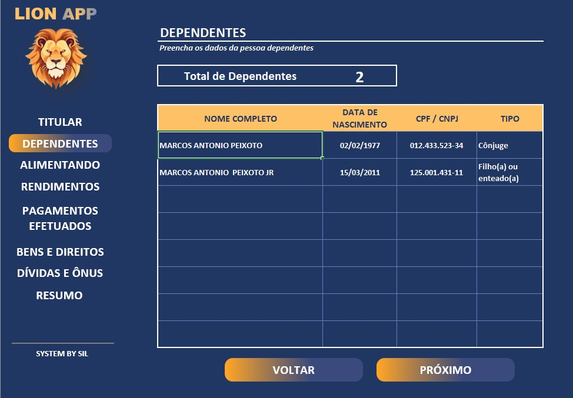
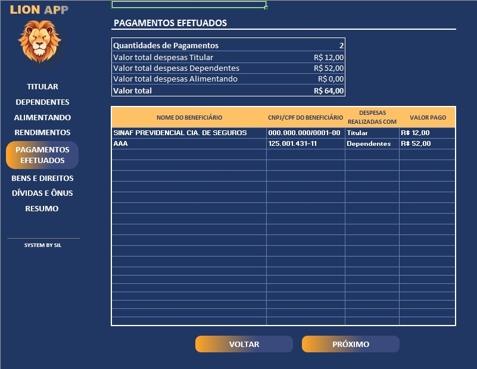
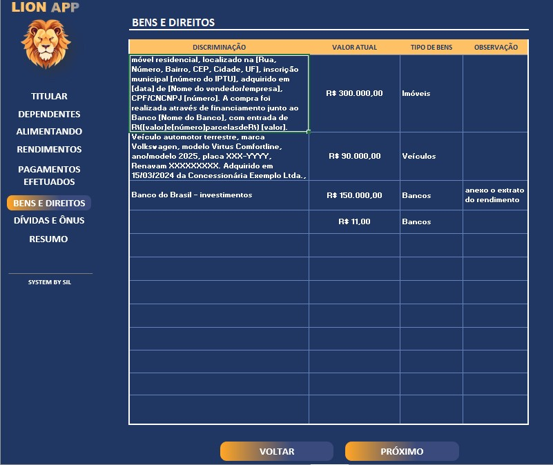
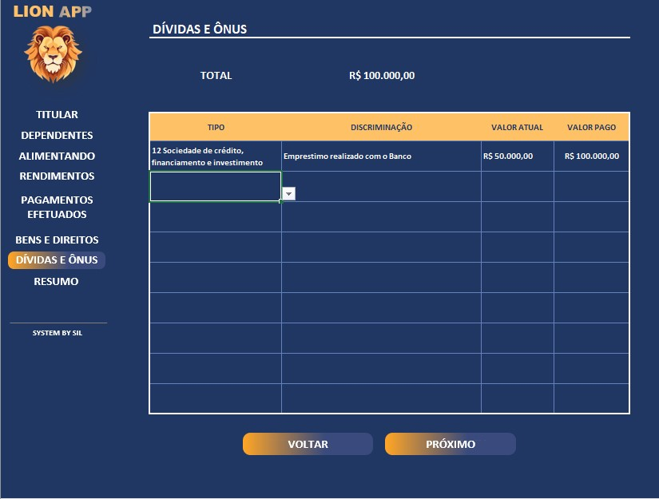

# 📊 Organizador de Declaração de Imposto de Renda

Ferramenta em **Excel** para organizar e reunir informações essenciais da declaração de imposto de renda.  
Inclui menus de navegação, validações automáticas e funcionalidades extras para facilitar o preenchimento.

---

## 🎯 Objetivos do Projeto
- Centralizar dados do titular, dependentes, alimentandos, rendimentos e bens.  
- Automatizar cálculos de totais (dependentes, pagamentos, rendimentos).  
- Validar entradas para evitar erros (ex.: CPF, datas, valores).  
- Criar interface amigável com menus de navegação.  
- Facilitar a exportação e consulta rápida de informações.  

---

## 🗂️ Estrutura dos Menus

| Menu                | Função                                                                 |
|---------------------|------------------------------------------------------------------------|
| **Titular**         | Dados pessoais, ocupação principal, nº recibo da última declaração.    |
| **Dependentes**     | Cadastro com cálculo automático do total de dependentes.               |
| **Alimentando**     | Registro de pensão alimentícia e despesas médicas/educacionais.        |
| **Rendimentos**     | Rendimentos tributáveis recebidos de PJ, IRRF e contribuições.         |
| **Pagamentos**      | Registro de despesas com titular, dependentes e alimentandos.          |
| **Bens e Direitos** | Imóveis, veículos, investimentos e discriminação detalhada.            |
| **Dívidas e Ônus**  | Registro de dívidas e obrigações financeiras.                         |
| **Resumo**          | Consolidação dos dados: rendimentos, despesas, bens e dívidas.        |

---

## ⚙️ Funcionalidades Técnicas

- 🔍 **Validações automáticas**: CPF, CNPJ, datas e valores.  
- 📊 **Cálculos automáticos**: totais de dependentes, pagamentos e rendimentos.  
- 🖱️ **Menus de navegação**: botões para acessar cada seção.  
- 📎 **Links rápidos**: atalhos para tabelas auxiliares (ex.: bancos, tipos de dependentes).  
- ⚠️ **Regras de preenchimento**: cálculos só são realizados quando todas as colunas obrigatórias estão preenchidas.  

---

## 🚀 Como Usar
1. Abra o arquivo `Projeto_Imposto.xlsx`.  
2. Navegue pelos menus disponíveis.  
3. Preencha os dados conforme solicitado.  
4. Confira os cálculos automáticos no **Resumo**.  
5. Utilize as tabelas auxiliares para padronizar informações (ex.: códigos de bancos).  

---
## 📦 Entrega dos Arquivos

Devido ao tamanho do arquivo original, foram geradas duas versões para facilitar a entrega:

- **Projeto_Imposto.rar** → Arquivo compactado contendo a versão original.  
- **Projeto_Imposto.xlsb** → Versão otimizada em formato binário do Excel, mais leve e rápida para abrir.  

👉 Recomenda-se utilizar a versão **.xlsb** para melhor desempenho.

---

## 📂 Estrutura do Repositório

Organizador-IR/

- **Projeto_Imposto.xlsx** → Arquivo principal em Excel com todas as abas (Titular, Dependentes, Rendimentos, etc).  
- **README.md** → Documento explicativo com objetivos, instruções e estrutura.  
- **/images** → Pasta opcional para armazenar capturas de tela da interface preenchida.  

---

## 📊 Resumo Consolidado com Cálculos Automáticos

A aba **Resumo** utiliza nomes definidos para facilitar a leitura das fórmulas:

| Categoria              | Nome Definido / Fórmula                                               |
|------------------------|----------------------------------------------------------------------|
| **Total de Dependentes** | `=total_dep` → Conta quantos dependentes foram cadastrados   |
| **Total de Pagamentos**  | `=total_pagto` → Soma todas as despesas registradas                  |
| **Pagamentos por Titular**  | `=desp_titular` → Soma apenas despesas do titular                   |
| **Pagamentos por Dependentes**  | `=desp_depend` → Soma apenas despesas dos dependentes          |
| **Pagamentos por Alimentando**  | `=desp_aliment` → Soma apenas despesas dos alimentando           |
| **Pagamentos efetuados**  | `=total_pagto` → Total das despesas 
| **Rendimentos Recebidos**| `=rend_recebido` → Total de rendimentos tributáveis recebidos    |
| **Bens e Direitos**  |`=cont.se(Bens!E$6:$E$17;C21)` → Quantidade de Imóveis   |
| **Bens e Direitos**  | `=cont.se(Bens!E$6:$E$17;C22)` → Quantidade de Veículos    |
| **Bens e Direitos**  | `=cont.se(Bens!E$6:$E$17;C23)` → Quantidade de Bancos      |
| **Dívidas e Ônus**     | `=divida` → Total de dívidas registradas                          |

---

## 🖼️ Capturas de Tela da Planilha

Abaixo estão exemplos das abas principais do organizador de imposto de renda:

### Titular

### Dependentes

### Alimentando

### Rendimentos

### Pagamentos Efetuados

### Bens e Direitos

### Dívidas e Ônus

### Resumo Consolidado

## ⚠️ Observações Importantes
- **Compatibilidade** : Recomendado o uso no Microsoft Excel 2019 ou superior.
- **Segurança**: Esta planilha é apenas um organizador. Os dados devem ser inseridos manualmente no programa oficial da Receita Federal.

---
## 👩‍💻 Autor

Projeto desenvolvido por **Silvana Argemiro Campos**  - https://www.linkedin.com/in/silvana-correia-campos

📍 Rio de Janeiro - RJ  

